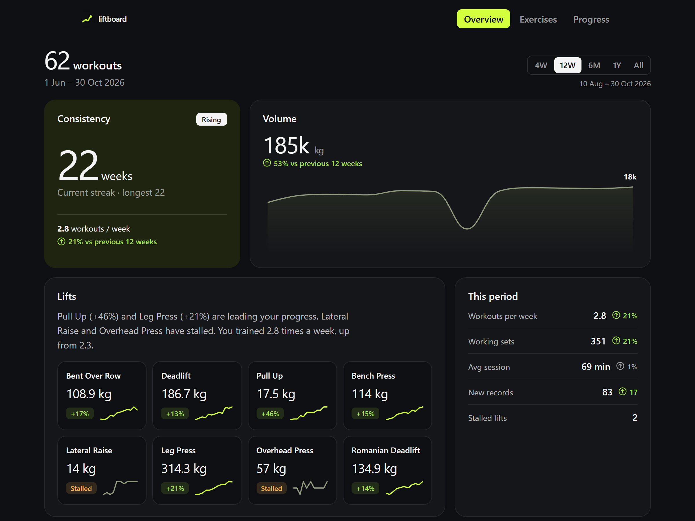
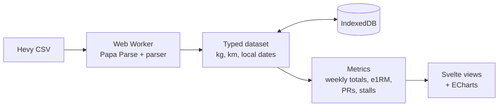

<picture>
  <source srcset="public/brand/logo-dark.svg" media="(prefers-color-scheme: dark)" />
  
</picture>

[](https://github.com/AmriArshad/Liftboard/actions/workflows/ci.yml)

Explore your Hevy workout history in the browser. Your CSV never leaves your device.



## Use it

1. In Hevy, go to **Settings → Export & Import Data → Export Workouts**.
2. Drop the CSV on the page, or try the demo.

You get an overview (workouts per week, weekly volume and sets), an exercise explorer (e1RM and
top set over time, every session) and your personal records and stalled lifts. kg or lb, light
or dark, phone or desktop.

## Privacy

There is no server. The CSV is read in your browser, the parsed data is kept in your browser's
IndexedDB until you press **Clear my data**, and no request ever carries your workouts. See
[ADR 0002](docs/adr/0002-no-backend.md).

## How it works



- `src/lib/parse/`: CSV → typed model, run in a Web Worker. Pure TypeScript.
- `src/lib/metrics/`: pure functions over the model, unit-tested with Vitest.
- `src/views/` and `src/components/`: Svelte 5 screens and one ECharts wrapper per chart type.
- Static files on Cloudflare Pages. Decisions are recorded in [`docs/adr/`](docs/adr/).

## Local development

Requires Node 24 (see `.nvmrc`).

```bash
npm install
npm run dev
```

| Command                 | What it does                               |
| ----------------------- | ------------------------------------------ |
| `npm run build`         | Production build to `dist/`                |
| `npm run preview`       | Serve the build                            |
| `npm run check`         | Type-check (svelte-check + tsc)            |
| `npm run lint`          | Prettier check + ESLint                    |
| `npm run format`        | Format everything with Prettier            |
| `npm test`              | Unit tests (Vitest)                        |
| `npm run test:e2e`      | End-to-end tests (Playwright)              |
| `npm run generate:demo` | Regenerate the synthetic `public/demo.csv` |
| `npm run size`          | Check the bundle-size budget (after build) |
| `npm run lighthouse`    | Check the Lighthouse budget (after build)  |

## Infrastructure and deployment

Terraform in [`infra/`](infra/) manages the Pages project, the `liftboard.amri.dev` domain and
its DNS record ([ADR 0004](docs/adr/0004-terraform.md)). Every pull request gets a Terraform
plan and a preview deploy posted as comments. Every push to `main` applies Terraform, then
deploys.

One-time setup, the only part done by hand:

1. Create an R2 bucket named `liftboard-tfstate`, and an R2 API token with Object Read &
   Write on it.
2. Create a Cloudflare API token with **Account · Cloudflare Pages: Edit**, **Zone · DNS:
   Edit** and **Zone · Zone: Read**, limited to the `amri.dev` zone.
3. Add the repository secrets `CLOUDFLARE_API_TOKEN`, `CLOUDFLARE_ACCOUNT_ID`,
   `R2_ACCESS_KEY_ID` and `R2_SECRET_ACCESS_KEY`.

Until all four are set, the plan, preview and deploy steps are skipped rather than failing.
